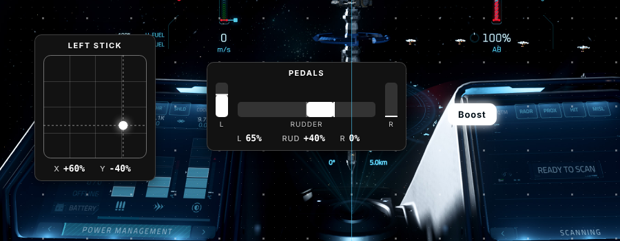
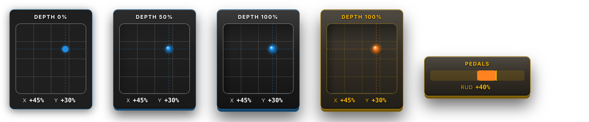
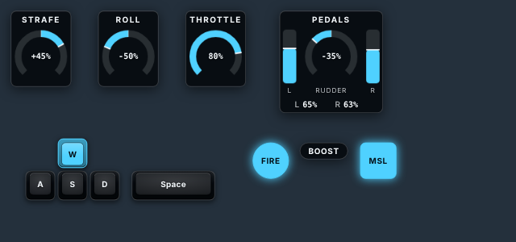
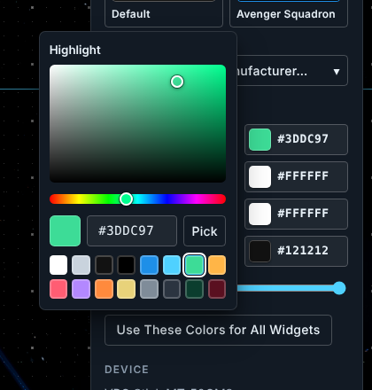
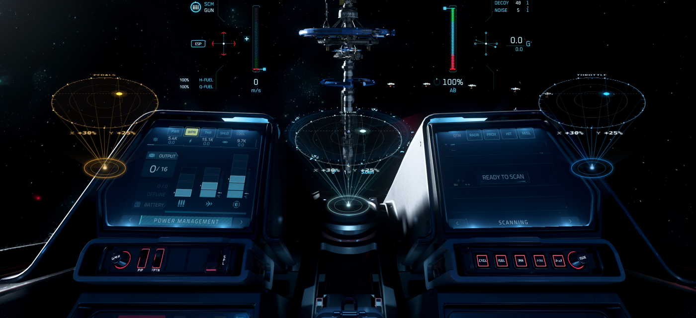

# Joystick Overlay Inputs (JOI)

An OBS overlay for Star Citizen pilots. It shows your sticks, throttle, pedals and buttons live on stream and in recordings, so you can watch replays back and see what your hands and feet were doing. It's a single HTML file with no install and no internet needed.



## Download

**[Download JOI.zip (latest version)](https://github.com/Adobe-Wan/Joystick-Overlay-Inputs-JOI/releases/latest/download/JOI.zip)**

1. Click the link above. Your browser saves `JOI.zip`.
2. Right-click the zip and choose **Extract All…** Put the folder somewhere permanent, for example `Documents\Joystick Overlay Inputs`. Don't run it from inside the zip or from your Downloads folder if you clean that out.
3. Follow **Set up in OBS** below.

Every version, with its change notes, is on the [Releases page](https://github.com/Adobe-Wan/Joystick-Overlay-Inputs-JOI/releases).

**Requirements:** Windows, a recent OBS Studio, and any joystick, throttle, pedals or button box that Windows sees as a game controller. Nothing else to install.

### Updating
Download the new zip and replace `JOI.html` in your folder. Keep your `profile.js`: your layout comes back automatically. You don't need to change anything in OBS.

**Coming from Stay On Target?** The app was renamed Joystick Overlay Inputs (JOI), and its file is now `JOI.html`. Put `JOI.html` in your existing folder next to your `profile.js`, then in OBS open the Browser source's properties and pick `JOI.html` as the local file. Your saved layout and settings carry over on their own.

## Set up in OBS
1. [Download](#download) and extract the zip. The folder holds `JOI.html`, the `Background Images for Edit Mode` sample screenshots, this README with its images and the license. Keep them together.
2. In OBS, add a **Browser** source, check **Local file** and pick `JOI.html`.
   - **Width / Height:** use your OBS canvas size (Settings → Video → Base Canvas, usually **1920 × 1080**). The overlay then maps 1:1 to your screen, and you position widgets by dragging them in step 4 rather than by moving the source.
   - **FPS:** check **Use custom frame rate** and set **60**.
3. Right-click the source and choose **Interact**. The first time, JOI opens in edit mode with a welcome dialog that asks **What do you fly with?** (Later, press **E** or click **Open Editor** to return; **Help** in the top bar brings the dialog back.)
4. Pick the setup closest to your hardware: **WASD + Mouse**, **HOSAS + Pedals** (two sticks), **HOTAS + Pedals** (stick and throttle), **HOSAM** (stick and mouse) or **Directional Inputs**. Each tile spells out its acronym and lists what it adds. The widgets appear along the bottom middle of the screen, where most streamers keep their inputs, named for what they fly (**Pitch / Yaw**, **Strafe**, **Roll**), and **Bind Inputs** opens:
   1. **Move it** when asked: push the stick fully right, then fully forward. It detects the axis and its direction. The browser only lists a controller once it has moved, so wiggle it if nothing happens.
   2. **Skip for Now** leaves a widget for later; **Bind Inputs** on the Setup panel (or in **Profiles & Share**) finishes the rest.

   Prefer to build it yourself? **Add Devices One by One** opens the same wizard for a single Stick, Pedals, Button/Key, Throttle, Single Axis or Label, and asks you to **Name It**. The round **+** button (bottom right, or press **A**) and **+ Add** in the top bar add more at any time.
5. Drag the widgets where you want them (see *Positioning* below). The **Reference Screenshot** on the Setup panel puts a Star Citizen screenshot behind the editor, so you can place them around the HUD instead of on top of it; it never shows on stream. Click a widget to change its name, binding, size or colors.
6. Switch **Edit Mode** off in the top bar (or press **E**). The reference screenshot disappears with the editor. The first time, a tip reminds you of step 7.
7. **Profiles & Share → Download profile.js**, and save it in the same folder as `JOI.html`. This keeps the setup safe if OBS clears its cache. OBS's own browser can't download files, so when you edit inside OBS (**Interact**) the Download buttons show the file's text instead: select **Copy**, paste it into Notepad, and save it with **Save as type** set to **All files** under the name the dialog gives.

Opened in a normal browser instead of OBS, the welcome says so and reminds you to add the file to OBS when the layout is ready.

## Opening it in a normal browser
Outside OBS the page shows a dark preview background with a note that it's transparent in OBS. In OBS it stays fully transparent. If another streaming app shows the dark background, add `?transparent` to the end of the file URL. Add `?edit` to open straight into the editor.

## 4K and other resolutions
Layouts are designed on a 1920×1080 canvas and **fit to the screen size** automatically, so a layout made at 1080p looks the same at 1440p or 4K, and the whole layout always fits in a shorter browser window or on an ultrawide. The editor's text scales up too. If a widget ever ends up outside the window, the editor home panel offers **Bring Into View**. Both can be changed in **Settings → Size** (*Fit overlay to screen size*, *Editor text size*).

**Moving a layout between screens.** Each profile remembers the screen shape it was arranged on. Open it on a different shape (a 4K browser tab with toolbars, a 1080p OBS source, an ultrawide) and each group of widgets keeps its place: things along the bottom middle stay at the bottom middle, and a widget near an edge or corner keeps its distance from it. Nothing is overwritten until you edit, so going back to the original screen puts everything back where it was. Profiles from v1.1 and earlier record their screen the next time you change something or download profile.js.

## Positioning
- **Reference screenshot.** The editor shows a Star Citizen screenshot behind your widgets so you can place them around the HUD. It only shows in the editor, never on stream. It's step 1 of setup, and you can change it any time on the editor home panel (**Load My Own Screenshot**, **No Screenshot**).
- **Center lines** (blue) mark the middle of the screen. While dragging, **smart guides** (pink) snap a widget's edges or center to the screen center, edges, safe margin and other widgets. When nothing is close, it snaps to the **grid**. Hold **Alt** to drag freely.
- **Select several:** drag a box on empty space, or Shift+click widgets. Ctrl+A selects all. Drag any selected widget to move them together.
- **Align and place:** with a selection, use the panel's align buttons (left, center, right, top, middle, bottom). *Center on Screen*, *Center Horizontally*, *Center at Bottom* and *Move to Bottom* move the selection as one block.
- **Spacing:** with 2+ selected, type a **Gap** in px (for example 16) and press **Space Horizontally** or **Space Vertically** to set them that far apart. Leave the gap on *Auto* to spread 3+ widgets evenly across their current width or height.
- **Nudge** with the arrow keys (Shift = 10px). **P** or **Hide Panel** hides the side panel so you can see the whole screen. **?** lists every shortcut.
- Grid size, safe margin, and turning guides or the grid off are in **Settings**.

## Sample backgrounds
Sample screenshots live in the `Background Images for Edit Mode` folder next to `JOI.html`. The download includes 16:9 and 21:9 ultrawide samples. The editor uses whichever sample best matches your screen shape, as long as the files keep these exact names:

| File | Screen shape |
|---|---|
| `16by9.jpg` | 1920×1080, 2560×1440, 3840×2160 |
| `21by9.jpg` | 3440×1440 ultrawide |
| `32by9.jpg` | 5120×1440 super-ultrawide |

Drop a new one into the folder and it appears in the editor on the next load. Keep the folder with the HTML when you share the app.

## Widget layout
Select a widget (or several). The side panel runs like Figma's: what you selected, its name, what it listens to (the device, key or mouse it is bound to, with **Bind** or **Rebind** beside it) and the align icons stay pinned at the top, **Duplicate** and **Remove** stay pinned at the bottom, and the sections in between go from where the widget sits, to its box, to how it looks:

**Position and Size**, **Arrange**, **Layout**, **Show**, **Color Theme**, **Colors**, **Cockpit Look**, **Projector**, then **Device** for a single widget. The style sections start folded so the first screen of the panel is position, layout and binding; click a section's title to open it, and it stays open.

With several widgets selected, every change applies to all of them. The first time setup finishes with two or more widgets, a tip points this out (once per browser).

**Position and Size**
- **X** and **Y** in pixels: the widget's top-left corner, or the group's.
- **Width** and **Height** in pixels: type a value, or drag a handle on the selected widget. Each corner has a handle, and each edge can be grabbed anywhere along its length. The opposite side stays put and the dragged edge snaps to the grid. **Shift** keeps the proportions, **Ctrl** resizes from the center, and **Alt** turns snapping off. Resizing never changes the padding: the box grows and the content stays centered in it. A box can't go smaller than its content, so use **Size** to shrink the content itself. **Fit to Content** clears it.
- **Match Width**, **Match Height** and **Match Both** (several widgets selected) make every selected widget as wide and/or as tall as the largest one.
- **Content** (sticks, throttles, single axes, pedals): **Fit** (default) keeps the stick, bar or rudder at its size, centered in the box. **Fill** grows it to fill the box as you resize: a stick stays square and grows to the shorter side, a bar or rudder grows along its length.
- **Size** (50 to 250%) scales the whole widget, content included: drag the slider or type a percentage. Size 100% is tuned to sit over the Star Citizen cockpit at 1080p: a 96 px stick gate, 96 px bars and rudders 12 px thick, and a 48 px dial (all on a 4 px grid). With **Auto** scale the overlay grows with the source, so it looks the same at 1440p or 4K. Widgets saved with an older version keep the size they had.

**Layout**
- **Padding** and **Corner radius**. The stick's inner box uses the same corner radius as the widget, so the corners match.
- **3D depth** (0 to 100%) gives the panel a beveled, raised edge, sinks the stick gate into the panel, and turns the stick's ball into a lit sphere with a shadow. It's drawn once with CSS shadows and gradients, so it adds no per-frame cost in OBS.

  
- **Display:** throttles and single axes can be **Vertical** (default), **Horizontal** or **Circular**. A horizontal bar starts at the same size as the pedals' rudder bar. On pedals, **Rudder display** stands the rudder upright between the brakes, lays it flat (default), or makes it Circular.
  - **Circular** turns the bar into a round dial with the % value in its middle. A single axis or the rudder fills from the top: clockwise (to the right) for positive, counterclockwise (to the left) for negative. A throttle fills clockwise from the dial's left end. The dial leaves a gap at the bottom, so -100% and +100% look different. **Dial size** (40 to 240 px) sets its diameter, and on pedals the brake bars stand as tall as the dial.
- **Shape** (Button/Key): **Box** (default, hugs the name like before), **Pill**, **Circle**, **Rounded Square** and **Keycap**, which looks like a key on a keyboard and sinks when pressed. Circle, Rounded Square and Keycap are at least one key wide (44 px at Size 100%); a longer name such as *Space* makes a wider key, and **Width scale** stretches it further (a spacebar at 250%, say).
- **Width scale** and **Height scale** (Button/Key, 25 to 400%) stretch the box on one axis without changing the text size. A very narrow button cuts off its label.
- **Inner sizes:** stick area for sticks (always a square 4×4 gate before any perspective), bar thickness and length for throttles and single axes, and rudder and brake bar sizes for pedals. These are in pixels before **Size**, which still scales the whole widget. A bar's or rudder's thickness (the Height of a horizontal bar, the Width of an upright one) goes down to 4 px; lengths go down to 20 px. The brakes beside a thin rudder get thin too, since they follow its thickness.
- **Reset Layout** puts them back to the defaults.

**Show** switches the **Name**, **Values** (%) and **Axis labels** on or off. Under **Axis labels**, **Call them** picks the words: a stick can say **X and Y**, **Yaw and Pitch** (YAW / PIT) or **Strafe** (L/R with U/D or F/B), pedals **Yaw** (the default, since pedals usually yaw in Star Citizen), **Roll** or **Rudder**. The presets set them, so a widget teaches the same words as the game's keybinding screen. **Text** sets one font and size for everything on the widget; **Set each text separately** gives the name, the values and the axis labels their own. On pedals with axis labels off, the rudder value is anchored to the widget's center: 0% sits dead center, right rudder grows the number to the right and left rudder grows it to the left, with the brake values under their bars.

Every slider's value is clickable: click it, type a number and press Enter (Escape keeps the old one).

**Arrange in Grid** (under **Arrange** > **Rows and Columns**, several widgets selected) lines them up in rows and columns from the group's top-left corner. **Columns: Auto** keeps the rows your widgets already roughly sit in, so a loose layout tidies up the way it looks; 1 to 6 sets the columns, filled in reading order. Each column is as wide as its widest widget and every widget is centered in its cell, using the **Gap** value (Auto uses the grid size). Match the sizes first for perfectly even cells. It runs once on click, so it costs nothing while you stream.

Widgets keep a fixed size while you fly. The % values reserve room for their widest reading, so moving a stick never resizes anything.

## Keyboard keys (WASD overlays)
A **Button/Key** can show a keyboard key instead of a device button. Choose **+ Button/Key** (or the round **+**), then press the key. It binds straight away, named after the letter it types on your keyboard, and shows as a **Keycap**. Space and Enter bind too; Escape closes the dialog and Tab moves between its buttons.

For movement keys, press **Add W, A, S and D Keys** in the same step. It adds the four keycaps laid out like a keyboard (W above S, A and D beside it) at the bottom middle, selected together so you can style them at once. Keys are stored by their place on the keyboard, so a binding survives a change of keyboard layout. **Detect Again** in the **Key** section rebinds one, to another key or to a device button.



**The catch in OBS:** a Browser source only receives key presses while it has keyboard focus, which in OBS means while its **Interact** window is open and focused. With the game in front, Windows sends the keys to the game, not to OBS, so the keycaps won't light during play from the browser source alone. Showing keys while you play needs a helper that listens to the keyboard system-wide; the planned in-game companion app is where that fits. Device buttons and axes normally keep working with the game in front; if they freeze too, see [Inputs freeze while the game is in front](#inputs-freeze-while-the-game-is-in-front).

## Profiles and presets
Keep a layout for each ship or controller setup and swap between them. Click **Profiles & Share** in the top bar: one panel holds your profiles, sharing and the `profile.js` backup. With nothing selected, the side panel shows **Setup**.

- **Switch** by clicking a profile in the list. Each profile has its own widgets, positions, colors and theme. Editor preferences (grid, snapping, guides, overlay scale, editor text size) belong to your computer and stay the same whichever profile is on screen.
- **+ New Profile** starts an empty one in your current colors. **Duplicate** copies the profile on screen, for a ship that's almost the same. Type in **Name** to rename it. **Delete** asks first; your only profile can't be deleted.
- **Download .json** saves the profile on screen as a file to share or keep. **Import a Profile** adds a file as a new profile next to yours; it never replaces one (an empty profile makes room for it). **Download profile.js** (under **Back Up Every Profile**) backs up every profile at once.
- **Undo** (Ctrl+Z) takes back a switch, rename, duplicate, delete, import or preset like any other edit.

**Start From a Preset** (the same tiles as the welcome's **What do you fly with?**) adds the widgets for a common setup as a new profile, in your current colors, lined up along the bottom middle:

| Preset | Widgets |
|---|---|
| **WASD + Mouse** | Q W E / A S D, Ctrl and Space keycaps, a mouse **Pitch / Yaw** widget and LMB / RMB keys |
| **HOSAS + Pedals** | Strafe (left stick), Up / Down, Pedals, Pitch / Yaw (right stick), Roll |
| **HOTAS + Pedals** | Throttle, Strafe (the throttle's thumbstick), Pedals, Pitch / Yaw (stick), Roll |
| **HOSAM** (Hands on Stick and Mouse) | Strafe (stick), Up / Down, Roll, a mouse **Pitch / Yaw** widget, LMB / RMB |
| **Directional Inputs** | Up, Left, Right and Down in a cross, for a hat, D-pad or arrow keys |

Every flight preset covers all six ways a ship moves: pitch and yaw, roll, and strafe left / right, up / down and forward / back. Widgets are named for what they fly. **Roll** is a dial (a circular Single Axis): bind it to the axis you roll with, usually a stick's twist. **Up / Down** is a bar for your vertical strafe axis. Rename or rebind any of them to match your own bindings. Keyboard keys and the mouse work straight away. Sticks, throttles, pedals and hat directions can't be guessed (every pilot's devices differ), so they start **not bound yet** and **Bind Inputs** opens: it asks you to move each device or press each button in turn, with the same steps as **+ Device**. **Skip for Now** leaves one for later, and the **Bind Inputs** button on both tabs picks up the rest.

The mouse **Pitch / Yaw** widget is a stick that shows which way and how fast the mouse moves, easing back to center when it stops. Like keys, the mouse reaches a Browser source only while its OBS **Interact** window has focus (see the catch under Keyboard keys), so it shows during play only with the planned in-game companion app. **Use a Device Instead** in its **Input** section turns it into a normal stick.

## Color themes
Match your widgets to your ship's MFDs. Select widgets and look under **Color Theme** in the side panel, or use the same controls in **Settings** to color every widget (new widgets then use it too).
- **Default** (neutral white on a fully opaque charcoal background, what new widgets start with) and **AVS** (Avenger Squadron: white, blue and black) are tiles at the top.
- **Ship manufacturer** is a dropdown with a color swatch on every row: Aegis Dynamics, Anvil Aerospace, AopoA, ARGO Astronautics, Banu Souli, Crusader Industries, Drake Interplanetary, Esperia, GATAC Manufacture, Greycat Industrial, Kruger Intergalactic, Mirai, MISC, Origin Jumpworks and Roberts Space Industries. Use the arrow keys or type a letter to jump.

Most themes are sampled from that manufacturer's in-game power management screen: the stick dot, bars and pressed buttons use the color of a filled power pip, the widget outline uses an empty pip's outline, and the background matches the screen. Crusader, Banu and AopoA are fan picks for now. You can still fine-tune Highlight, Text, Border and Background by hand underneath.



Click a color to open the picker: drag in the square for saturation and brightness (or use the arrow keys, Shift for bigger steps), drag the rainbow bar for hue, type a hex code, click a preset, or use **Pick** to grab a color from anywhere on screen (where the browser supports it). Escape or a click outside closes it.

## Cockpit Look (perspective and projection)
Select a widget (or several) and use **Cockpit Look** in the side panel to make it sit naturally in your cockpit, either on an angled screen or projected like a hologram. Widgets start Flat; the looks are optional.
- **Style:** **Flat** or **Projector** comes first. Flat shows the **Screens** presets (Flat, Left, Right, Dash, Low Left, Low Right, Overhead) and **Holograms** (Facing You, Visor HUD, Canopy Glass, Left Wall, Right Wall); Projector shows the Projector presets described in the next section. Hover a tile for its full name and a short description; the section header shows the style and the active preset.
- Under the presets, for both styles and always visible: **Angle** (Tilt, Turn, Rotate, Skew X, Skew Y and Perspective, lower is stronger) and **Light and Background**: Glow (a halo in your highlight color, so it follows the theme), Background fade (lets the scene show through; the line under it says what the background actually shows at, from Background opacity in **Colors** and the fade) and Scanlines (off unless you turn them on).
- **Reset to Flat** undoes all of it.
- Snapping and alignment use the widget's flat footprint, so the tilted corners can sit slightly outside the guides.

Perspective is a single CSS 3D transform per widget, which the GPU composites, and the projection effects are painted once. They cost nothing per frame, and flat widgets skip them entirely.

## Projector look
Projector makes a widget look like a hologram emitted from a small projector base on your dashboard, the way the Gladius cockpit's center radar is: a disc of light floating above a dark pedestal, held up by thin rays reaching every corner, in your ship manufacturer's colors. It's off by default.



- **Turn it on:** select a widget and choose **Projector** as the **Style** under **Cockpit Look**, then pick a preset (**Dash Radar**, **Dash**, **Left**, **Right**, **Overhead**) if you like; the **Projector** section with its own controls appears below. Switching it on gives a Stick its **Radar** face and leaves your background and scanlines as they were; switching back to Flat puts the face back. Motion, Float, Flicker and Color Fringe all start off, so you add the effects one at a time.
- **Face** (Sticks, in the **Layout** section): **Square** is the usual gate with a grid, **Radar** a round disc with rings and rim ticks. Radar works with or without Projector, with the heatmap too.
- **Grid** (Sticks, at the end of **Layout**): **Lines** sets the square gate's grid, from **None** through **2×2** (quadrants), **3×3**, **4×4** (the default), **6×6** and **8×8**; a Radar face gets **Rings** instead (None to 4). **Bold Center Lines** draws the two main lines as bright as the border, and **Outer Border** off leaves the grid open at its edges. For just the center cross, pick None, turn Bold Center Lines on and Outer Border off.
- **Stick Area** (Sticks, in **Colors**): a fill just behind the stick, with its own color and opacity, separate from the widget's Background. Set Background opacity to 0 and Stick area opacity up, and a Radar reads as a true circle with contrast behind it.
- **Motion:** **Still** paints everything once and costs nothing per frame. **Subtle** adds a slow float and a rare, gentle dropout. **Full** adds a color split and tear during dropouts, photons riding the rays, dust in the beam and a breathing base. If your system asks for reduced motion, Projector stays Still. If Full makes frames noticeably slower, it drops to Subtle for that session and tells you.
- **Basics:** Motion, **Intensity** and **Scene**.
- **Base and Beams:** **Projector position** (Below, Above, Left, Right), **Base size**, **Move left or right** and **Move up or down** (where the base sits), **Rays reach** (**Every Corner**, the default: one ray to each corner of the widget and any more spread around its outline, drawn over the widget like light through the hologram; or **Near Edge**: a fan along the edge facing the base), **Rays** (0 hides them) and **Cone**.
- **Effects:** **Fade toward base** (how much the drawn face dims toward the base; 0 keeps it even, readouts and titles always stay full strength), then **Float**, **Flicker** and **Color Fringe**, which need Subtle or Full motion.
- **Scene: Dark / Bright.** Over planet glare, clouds or a bright sky, low-alpha light disappears. **Bright** brightens the base, rays and cone, turns the scanlines into lines of your highlight color and firms up the border so readouts stay legible.
- **Project from One Base** (with several widgets selected) aims every selected widget at one base under the group. Dragging the group keeps them together; moving one widget on its own breaks the group, and you can press it again.
- **Reset Projector** turns it off for the selected widgets; **Reset to Flat** removes it along with the rest of the look. While Projector is on, **3D depth** has no effect.

Every color in the effect comes from the widget's theme, so switching the theme recolors the base, rays and glow. Themes with a near-white highlight borrow their border color (Esperia's pink) or use a cool white (RSI, Default).

**OBS tips.** The page can't add light to the game footage behind it (OBS composites the overlay on top), so the hologram fakes it with low alphas and white-pushed cores. For true additive light, right-click the browser source in OBS and set **Blending Mode** to **Screen** or **Additive**. The Subtle and Full tiers depend on **Enable Browser Source Hardware Acceleration** (see below).

## Performance in OBS
If the overlay lags behind your game, or OBS's stats show rendering lag or skipped frames:
- **Settings → Performance → Draw rate** is how many times a second the overlay redraws while you move your controls. **60 FPS** is the smoothest. **30 FPS** halves the work OBS does for JOI: motion looks a little less smooth, but a press still shows right away. Pick it if the overlay stutters, lags or falls out of sync with your game. It applies to every profile.
- **Projector Subtle and Full** animate even when nothing moves, so OBS keeps redrawing the source (60 times a second, or 30 at a 30 FPS draw rate). **Static** or **Flat** costs nothing while your hands are off the controls.
- Make the Browser source the same size as your OBS canvas (Base Resolution), not larger: a 4K source is four times the work of a 1080p one. JOI scales its layout to the source size.
- Widgets only redraw when an input actually changes. Small wobbles a stick, throttle or pedal makes at rest (under half a percent) are ignored, so a resting device costs nothing to draw.
- Keep **Enable Browser Source Hardware Acceleration** on (OBS Settings, Advanced). That's the default. The Projector look's Subtle and Full motion tiers rely on it: without it their float and glow are drawn on the CPU every frame.
- Set the Browser Source FPS to 60. Going higher only adds load. If OBS is still struggling, tick **Use custom frame rate** in the source's properties and set it to 30: OBS then asks the page for only 30 frames a second, whatever is on screen.
- If the overlay is always a little behind the game but smooth, it's latency rather than load: add a **Render Delay** filter to your game capture (start around 30 to 50 ms) to line the two up.

## Keys (in edit mode or OBS Interact)
The single-key shortcuts work when no button or field has focus: click an empty part of the screen first.

| Key | Action |
|---|---|
| E, double-click, or the Edit Mode switch | Open / close the editor |
| A | Open the round + menu (add a device, button or label) |
| H | Show / hide the session heatmap |
| R | Reset the session heatmap |
| Delete or Backspace | Remove the selected widgets |
| Arrows / Shift+arrows | Nudge 1px / 10px |
| Ctrl+A / Ctrl+D | Select all / duplicate |
| Ctrl+Z / Ctrl+Y | Undo / redo (also Ctrl+Shift+Z; the small buttons above the + do the same) |
| P | Hide / show the side panel |
| ? | The shortcut list |
| Alt (while dragging) | Turn snapping off |

## Review: the session heatmap
JOI records where every stick, throttle and pedal spends its time. **Review** in the top bar shows it (or press **H**), for example which way you strafe most this session, and lists, for each axis widget, how much of the session it spent at full deflection and how much at rest. Pinning a stick to its stops is the most common new-pilot habit; if an axis lives at full deflection, fly the same fight again with half the input and compare the replays. **Reset** (or **R**) starts the numbers fresh.

## Two identical sticks (for example, 2× VIRPIL Alpha Prime)
They report the same hardware name, so JOI tells them apart by the controller slot each one was set up in, which Windows normally keeps stable. If left and right ever come up reversed, click either stick widget and press **Swap with Identical Device**.
For a permanent fix, give one stick a different USB Product ID in VPC Configurator, then re-add that stick.

## Starting over
**Reset All** (on the editor's home panel, and in **Settings → Start Over**) asks for confirmation, then removes every widget and returns all settings, colors and the reference screenshot to their defaults. It can't be undone, so use **Profiles & Share** first if you might want the layout back.

## A device isn't showing up
Open the editor and click **Check Devices** on the home panel. It lists every controller your browser is passing to JOI, live, and which widgets are still waiting for theirs.
- **Wake it up.** Browsers hide controllers until you use them after the page opens. Pedals have no buttons, so push a pedal or a toe pedal all the way once. The Setup panel lists every device the browser has seen.
- **Four controllers at most.** Browsers and OBS show no more than 4 game controllers at a time. If all 4 slots are taken, a fifth device (often the pedals) gets left out. Unplug or disable what you don't need on stream: a spare throttle, a wheel, an Xbox pad, or virtual controllers from Steam, vJoy or similar tools. Win+R, `joy.cpl` lists everything Windows sees.
- **Different browsers.** A layout made in OBS also works in Chrome, Edge or Firefox; devices are matched by their USB ids.
- **Remap a widget.** Select it and click **Detect Device** under *Device*. You move the stick or pedals (or press the button) again, and the widget switches to whatever you used, keeping its name, place, size and colors.
- Still missing? Close other apps that read controllers, unplug the device and plug it back in, then refresh.

## Inputs freeze while the game is in front
If the widgets move while OBS is the active window but stop as soon as you click into Star Citizen, work down this list. JOI itself doesn't pause when it loses focus; it can only show what OBS's browser passes it.
- **Only keycaps freeze?** That's expected: see [Keyboard keys](#keyboard-keys-wasd-overlays). Device buttons and axes are separate.
- **Is the source on air?** To save work, JOI pauses while OBS reports the source hidden or not in the live Program scene (for example, only in the Studio Mode preview). Edit mode keeps it running. Put the scene on Program and check again.
- **OBS 31 and newer: turn off Windows.Gaming.Input.** The browser inside OBS 31 reads Xbox-style controllers through Windows.Gaming.Input, which only reports to the window in front. Close OBS, right-click its shortcut, choose **Properties**, and add this to the end of **Target**, after the closing quote and a space:

  ```
  --disable-features=EnableWindowsGamingInputDataFetcher
  ```

  Start OBS from that shortcut every time (pin it to the taskbar from there). OBS users report this restores background input for gamepad overlays.
- **Run OBS at the same level as the game.** Windows doesn't pass input from an app running as administrator to one that isn't. If Star Citizen or the RSI Launcher runs as administrator, run OBS as administrator too (shortcut **Properties → Compatibility → Run this program as an administrator**), or run neither that way.
- **Still frozen?** Note your OBS version (Help → About) and which widgets freeze (sticks, pedals, buttons, or all of them), and open an issue.

## Sharing a layout
In **Profiles & Share**, click **Download .json** under **This Profile** and send that file (plus `JOI.html` if they don't have it yet). It holds the profile on screen. They open the editor and choose **Import a Profile**, which adds it as a new profile next to theirs. With the same hardware it works right away. With different hardware they select each widget and press **Detect Device** to use their own.

Don't send your `profile.js`, and never use one someone else sent you. It's a personal backup that sits next to your own `JOI.html`, and it runs as a script when the overlay loads (see `SECURITY.md`). A `.json` is only data.

## License and credits
- **License:** MIT (see `LICENSE`). Anyone can use, share and modify JOI for free, as long as the license notice stays with it.
- **Third-party code:** none. JOI uses no libraries, frameworks, web fonts, analytics or online services. It's one HTML file using built-in browser features (Gamepad API, Canvas, CSS), and text uses the fonts already on the viewer's computer. Nothing is downloaded and nothing about you or your inputs leaves your PC.
- **Design:** the editor's layout borrows from Material Design (MUI), re-created in plain CSS. No MUI code is included.
- **Color themes:** fan-made approximations of in-game MFD colors. They're not official assets.
- **Sample screenshots:** captured from Star Citizen. Game imagery belongs to Cloud Imperium.

This is an unofficial Star Citizen fan project, not affiliated with the Cloud Imperium group of companies. Star Citizen®, Roberts Space Industries® and Cloud Imperium® are trademarks of Cloud Imperium Rights LLC. Ship manufacturer names are used only to describe color themes.
